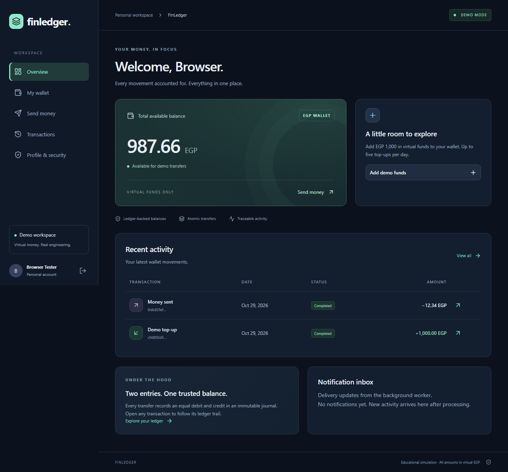
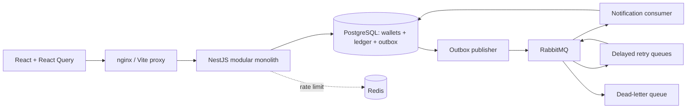
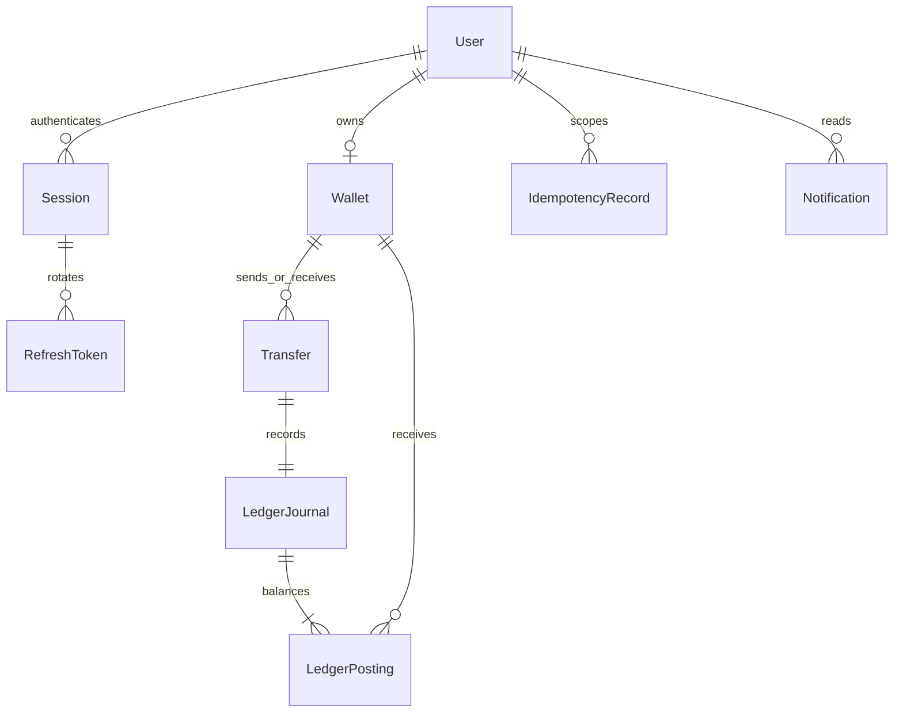
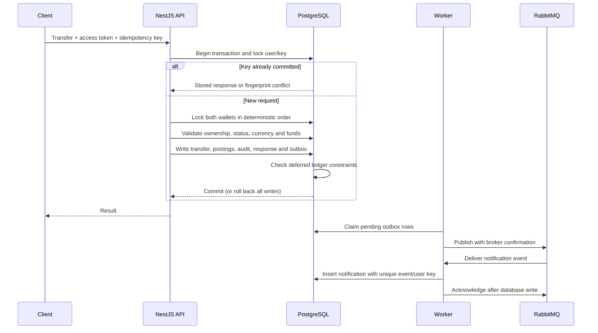
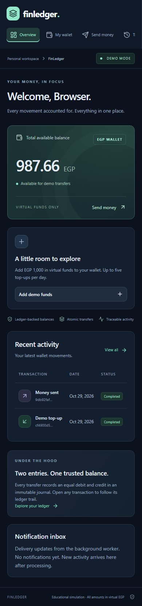

# FinLedger

**A ledger-backed wallet simulator built to make financial correctness explicit.**

FinLedger is a modular NestJS application with a React dashboard. It models virtual EGP transfers using an immutable double-entry ledger, PostgreSQL row locks, durable idempotency and a transactional outbox. No payment providers, bank credentials, deposits or real money are involved.

The engineering focus is handling the difficult cases: two requests spending the same balance, a client retrying after a lost response, and a broker failing after a database commit. PostgreSQL owns financial correctness; asynchronous notifications can recover independently.

Start with the Docker demo below, inspect the [ledger implementation](apps/api/src/ledger/ledger.service.ts), or read the [latest GitHub readiness evidence](GITHUB_READINESS_REPORT.md). [Interview notes and CV bullets](docs/portfolio.md) explain the design without claiming production deployment.



## Run with Docker

Requirements: Docker Desktop/Engine with Compose, and Node.js 24.11+ for generating local configuration.

Run these commands from the repository root. Use Node **24.x** (the supported engine range is `>=24.11 <25`). The local ports 3000, 8080, 55432, 56379, 5673 and 15673 must be free. If `.env` already exists, skip the first command.

```sh
node scripts/setup-env.mjs
docker compose up -d --build --wait
docker compose exec api npm run db:seed
```

Open [the dashboard](http://localhost:8080), [Swagger](http://localhost:3000/api/docs), or [RabbitMQ management](http://localhost:15673). RabbitMQ credentials are the randomly generated values in your local `.env`. The setup script refuses to overwrite an existing `.env`.

Development accounts: `alice@example.test`, `bob@example.test`, `admin@example.test`. Password: `FinLedger-Demo-2026!`. These are deliberately public **simulator** credentials. Seeding is refused when `NODE_ENV=production`. Each seed wallet receives EGP 1,000 through the ledger; rerunning the seed does not fund it twice.

To stop: `docker compose stop`. To remove containers while preserving data: `docker compose down`. Volumes contain financial simulation history; do not remove them if that history matters.

## Local development

```sh
npm ci
node scripts/setup-env.mjs  # first time only
docker compose --profile test up -d --wait postgres postgres-test redis rabbitmq
npm run db:generate
npm run db:migrate
npm run db:test
npm run build -w @finledger/shared
npm run db:seed
npm run dev:api
# in a second terminal
npm run dev:web
# in a third terminal, after building the API
npm run build -w @finledger/api
node --env-file=.env apps/api/dist/src/worker.js
```

The Vite proxy uses the same `/api` path as nginx. Use `http://localhost:8080`, matching `WEB_ORIGIN`. Money values in requests and responses are decimal **strings of minor units**: `"1234"` means EGP 12.34. JavaScript floating-point arithmetic is never used for financial amounts.

## Features

- Argon2id passwords, JWT access tokens, rotating HTTP-only refresh cookies, replay detection, immediate session revocation and USER/ADMIN authorization.
- One EGP wallet per user, ledger-backed demo funding, atomic transfers, paginated/filterable transaction history and private ledger details.
- Database-enforced balanced postings, immutable journals, nonnegative user balances and balance-cache reconciliation at commit.
- Idempotent money writes with a user-scoped key, payload fingerprint, stored response, database uniqueness and transaction-scoped advisory locks.
- Deterministic wallet row locks, bounded deadlock/serialization retries and database-enforced demo funding quotas.
- RabbitMQ publisher confirmations, durable queues, consumer acknowledgements, delayed retries, dead-letter handling and deduplicated notifications.
- Redis rate limiting with a local fallback; Redis and RabbitMQ outages do not change PostgreSQL financial correctness.
- Responsive React dashboard with React Query, real API actions, in-memory access tokens, coordinated refresh, loading/error/empty states and admin operations views.
- Correlation IDs, structured request logs, health checks, basic request metrics, Docker, GitHub Actions and executable load tests.

## Architecture



PostgreSQL is the sole source of truth. The balance is a cache maintained by a posting trigger and verified against the ledger at commit. The treasury is a virtual issuance contra-account whose negative balance offsets all positive user liabilities. See [ledger design](docs/ledger-design.md) for the accounting and tradeoffs.

### Database and ledger



Each committed transfer has one journal and exactly two equal postings: a debit to the sender and a credit to the recipient. User wallets represent liabilities, so credits increase their balance. SQL migrations add deferred constraints beyond the Prisma schema: balanced journals, matching transfers, cache reconciliation and nonnegative user balances. The virtual treasury is the deliberate negative-balance exception. Journals and postings cannot be edited to rewrite history.

### Financial transaction flow



Row locks serialize competing writes to the same wallets; deterministic ordering reduces deadlocks and bounded retries handle retryable database failures. Amounts use PostgreSQL `BIGINT` and JavaScript `bigint`, with decimal strings at the JSON boundary. An idempotency record is scoped to the authenticated user and committed with the transfer. Repeated requests return the stored response; changed payloads return HTTP 409. Delivery is **at least once**: consumer uniqueness prevents duplicate inbox effects, without claiming exactly-once broker delivery.

### Security architecture

Passwords are hashed with Argon2id. Short-lived JWT access tokens stay in browser memory; refresh tokens use HTTP-only, SameSite cookies, hashed storage, rotation and session-family revocation on reuse. The API checks current session state and roles, and verifies wallet/transaction ownership. Production enables Secure cookies, exact HTTPS origins and trusted proxy restrictions.

Production configuration separates database migration and runtime credentials, requires verified infrastructure TLS, protects metrics with an independent bearer token, and keeps secrets outside images and Git. The local Docker demo deliberately uses simpler loopback infrastructure. The production configuration and local hardening tests are evidence of preparation, **not a claim that this project is publicly deployed or independently security-certified**.

## Repository

```text
apps/api/src/        auth, users, wallets, transfers, ledger, transactions,
                    notifications, audit, admin, health, infrastructure
apps/api/prisma/     schema, migrations, development seed
apps/api/test/       Jest unit + PostgreSQL/RabbitMQ integration tests
apps/web/src/        React routes, API/session client, responsive styles
packages/shared/    exact monetary parsing and formatting
tests/e2e/          Playwright full browser workflow
scripts/            environment, isolated tests, load measurement
docker/             API/web images and nginx
docs/               architecture, database, ledger, API, testing, deployment
.github/workflows/  CI verification pipeline
```

Stack: Node.js 24 LTS, NestJS 11, TypeScript 5.9, PostgreSQL 17, Prisma 7, Redis 7, RabbitMQ 4, Passport/JWT, class-validator, Swagger, Jest/Supertest, React 19, Vite 7, Tailwind 4, React Query and React Router. Lockfile pins the installed dependency graph. Compatible transitive security patches are documented in the package overrides.

## Verify

```sh
npm run format:check
npm run lint
npm run typecheck
npm test
npm run test:integration
npm run build
npx playwright install chromium
npm run test:e2e
node scripts/check-secrets.mjs
# with the development API running
node scripts/load.mjs
node scripts/check-integrity.mjs
```

`npm run verify` runs formatting, lint, types, unit/integration tests, builds and browser E2E in sequence. Its isolated browser servers require free ports 3100/8180 and can run alongside the Docker demo. Alternatively, set `E2E_EXTERNAL=1` and `E2E_URL=http://localhost:8080` to exercise the running Docker stack; the test-only admin provisioning case is skipped in external mode.

The integration suite refuses to run without a `TEST_DATABASE_URL` naming an isolated `*_test` database. It uses a real PostgreSQL instance and real RabbitMQ queues. The concurrency case sends **50 simultaneous HTTP transfers**, with funds for only 10. It checks 10 successes, 40 insufficient-funds responses, zero final sender balance, global conservation, unique transfer IDs and balanced journals. Another case sends 20 concurrent copies of one idempotent request. See [test documentation](docs/testing.md) and [verification results](docs/verification.md) for actual results and limits.

Portfolio verification on **29 October 2026 passed 67 tests: 31 unit, 33 integration and 3 Chromium browser cases**. Formatting, lint, typecheck and all workspace builds also passed. A fresh Docker rehearsal verified migrations, seed logins, repeat-seed safety and ledger reconciliation. Runtime dependency audit: zero findings; development dependencies: six low-severity findings remain.

Exact commands, evidence and limits are in [GITHUB_READINESS_REPORT.md](GITHUB_READINESS_REPORT.md). Historical reports record 40 tests at initial implementation, 48 after audit and 67 after hardening. Test counts are not coverage percentages; no line or branch coverage claim is made.

## API documentation

After Docker startup, open [Swagger UI](http://localhost:3000/api/docs) or the [OpenAPI JSON](http://localhost:3000/api/docs-json). The API is versioned under `/api/v1`; [endpoint documentation](docs/api.md) describes authentication, wallets, transfers, history, notifications and administration. Authenticate to obtain an access token and use Swagger's bearer authorization. Funding and transfer requests require an `Idempotency-Key`. Production disables public Swagger and protects monitoring endpoints.

## Application screenshots

The desktop image above and [mobile dashboard](docs/screenshots/mobile.png) are captured by Playwright from the actual React application using the actual test API, fictional users and virtual balances. They are not design mockups. Screenshot files are prepared locally; nothing has been published remotely.



## Example transfer

1. Sign in as Bob, open **My wallet**, and copy his wallet ID.
2. Sign out, sign in as Alice, and open **Send money**.
3. Paste Bob's ID and enter `12.34` EGP.
4. Open the completed transaction to inspect its equal debit and credit.
5. Review the asynchronous notification inbox. The transfer remains complete even if the worker is offline.

API clients send `Authorization: Bearer <access-token>` and a fresh `Idempotency-Key` for each intended transfer. Retry an uncertain request using the **same key and payload**. Reusing a committed key with different parameters returns 409.

## Security, deployment and limitations

Production hardening is documented in [PRODUCTION_READINESS_REPORT.md](PRODUCTION_READINESS_REPORT.md). The separate [production/staging guide](docs/production-deployment.md) covers restricted database roles, mandatory infrastructure TLS, Caddy HTTPS, protected Prometheus metrics and deployment gates. [Backup and recovery](docs/backup-recovery.md) describes encrypted dumps and restores into new isolated databases. Preparation does not authorize deployment.

Additional checks after building: `npm run test:hardening`, `node scripts/tls-check.mjs`, and `node scripts/database-tls-check.mjs`. They use isolated local test resources; read the test documentation before running. The existing local Compose configuration remains unchanged and continues to use local reviewer credentials.

The supplied Compose configuration binds services to loopback for local review. Production hosting requires HTTPS, managed secrets, separate migration/runtime database roles, backups, monitoring and broker/network access controls. See [deployment](docs/deployment.md). This is a portfolio simulator, not a regulated or audited payment platform.

Known tradeoffs: a single currency, no reversals, no account recovery/MFA, process-local basic metrics, process-local throttling fallback during Redis outages, retained sessions/idempotency history without a retention job, and single-node infrastructure. Notification "emails" are inbox records; no messages leave the system. Browser pending idempotency keys survive navigation and reload in the same tab through sessionStorage; closing the tab, clearing storage, or changing browsers loses that recovery context. Retry the same payload to recover an uncertain operation. API clients should persist their own keys. Future work: reversal journals, MFA, cursor pagination, durable metrics aggregation and tested alert delivery, archival/retention, operational replay UI and replicated infrastructure.

The latest portfolio results are in [GITHUB_READINESS_REPORT.md](GITHUB_READINESS_REPORT.md). [FINAL_AUDIT_REPORT.md](FINAL_AUDIT_REPORT.md) and [PRODUCTION_READINESS_REPORT.md](PRODUCTION_READINESS_REPORT.md) preserve earlier engineering evidence and deployment blockers. Historical build verification is not a claim of production certification.

More: [architecture](docs/architecture.md) · [database](docs/database-design.md) · [ledger](docs/ledger-design.md) · [API](docs/api.md) · [testing](docs/testing.md).
