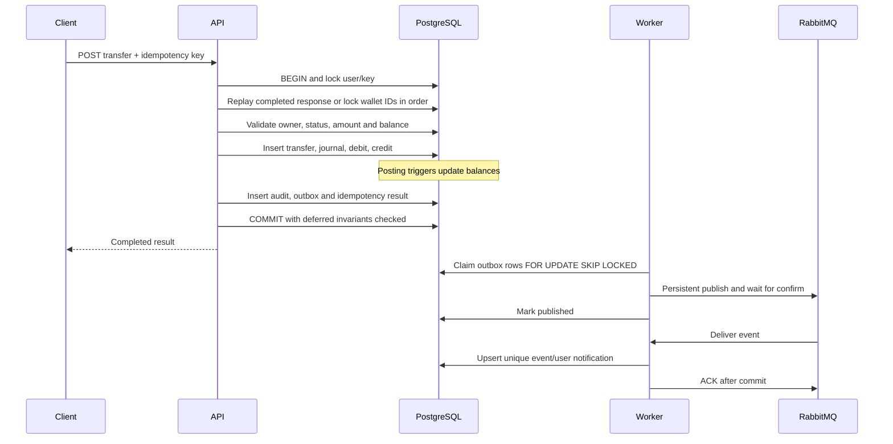

# Architecture and decisions

The modular monolith shares one PostgreSQL transaction boundary. Authentication owns sessions; Wallets owns wallet discovery; Transfers orchestrates requests through Ledger; Transactions serves private history; Notifications owns asynchronous side effects; Admin exposes restricted diagnostics. Users, Audit and Health provide focused read boundaries. Controllers validate HTTP input; LedgerService holds money-changing domain rules; Database and EventWorker implement persistence/infrastructure.

## Transfer sequence

Read Committed plus explicit row locking is sufficient: all spend decisions occur after acquiring both wallet locks. Deterministic UUID order avoids opposite-direction transfer deadlocks. PostgreSQL deadlock/serialization failures retry the whole transaction at most four times with bounded jitter. The idempotency lock lives within that same transaction. Hash collisions merely serialize unrelated keys; the unique `(userId,key)` record is the durable guarantee.

Redis is a fixed-window rate limiter, never a financial lock. A process-local fallback preserves availability, with weaker distributed abuse protection. Demo funding has an additional PostgreSQL quota under the wallet lock: no more than five grants / EGP 5,000 per rolling 24 hours. Financial API readiness depends on PostgreSQL; operational monitoring should independently watch broker/Redis/worker health.

Outbox publication is at least once: a publisher crash after broker confirmation but before database commit produces a duplicate on retry. Consumers upsert by `(eventId,userId)` and acknowledge only after the notification transaction commits. Three delayed consumer retries use 1s, 5s and 30s queues, then a dead-letter queue. Publisher errors retry exponentially up to 60s and quarantine after 20 attempts. Dead jobs are visible to admins. Classic RabbitMQ TTL/dead-letter forwarding has broker-level reliability limits during failures; use quorum queues with at-least-once dead-lettering for stronger multi-node guarantees before a public deployment.

The SQL balance reconciliation checks aggregate a wallet's ledger at commit. This makes corruption hard to hide, but cost grows with history. It is an intentional correctness-first portfolio tradeoff; a higher-volume design would use carefully audited posting-only write privileges and independently scheduled reconciliation.

## Threat boundaries

Clients cannot set roles, balances, treasury IDs, or ledger postings. DTO validation rejects unknown fields. Access tokens have fixed issuer/audience/algorithm and carry a session ID; each authorized request checks the live session and current role. Refresh secrets are random and stored only as SHA-256 hashes; used tokens remain available for reuse detection. Replay revokes the session family. Absolute session lifetime is seven days; access lifetime is fifteen minutes. Cookie writes check Origin when present, and cookies use SameSite Strict and HTTP-only (Secure in production). Access tokens remain in memory. Redis/HTTP logs contain no request bodies, tokens, cookies or credentials.
