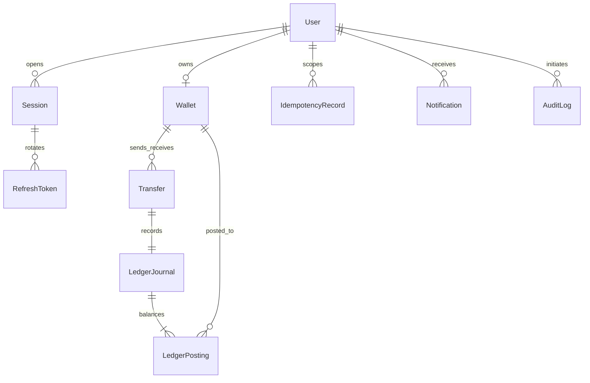

# Database design

UUIDs identify all records. `Wallet.balance`, `Transfer.amount` and `LedgerPosting.amount` are PostgreSQL BIGINTs and Prisma bigints. Only decimal strings cross the JSON boundary. EGP is enforced in SQL and request validation. Balances are limited to ±9 quadrillion minor units; user balances must be nonnegative. Transfer maximum is 10,000,000 minor units.

User email, user wallet, treasury system key, refresh hash, transfer journal, journal posting side, user/idempotency key and event/user notification all have unique constraints. History indexes cover both transfer wallet directions with creation time, postings by wallet/time, pending outbox scheduling and audit/notification retrieval.

The treasury has a fixed UUID, no owner and a unique `SIMULATOR_TREASURY` system key. Every other wallet has exactly one user and no system key. Wallet identity and currency cannot be changed. Audit records, transfers, postings, journals and successful idempotency records reject updates, deletion and truncation. Database owners can disable triggers; a production runtime role must not own the schema or have DDL privileges.

Deferred journal triggers require precisely one debit and one credit matching the transfer's amount and endpoints. A transfer without its journal cannot commit. The posting trigger changes the wallet cache; a deferred wallet trigger compares that cache with all signed postings. Direct unsupported balance writes therefore fail at commit.

Outbox rows retain publishing attempts, next-attempt time, sanitized last error, publication time and dead-letter time. Their payload contains only transfer metadata and internal user IDs, not passwords, tokens or bank information. Notification event IDs refer logically to retained outbox IDs. Historical records are intentionally retained; retention/archive policies are future work.

Migrations are ordered and applied with `prisma migrate deploy`. Never use `db push` as a replacement: Prisma's schema cannot represent the custom ledger triggers and checks. Always test migrations against a fresh PostgreSQL database.
